# Virtual Intel Mac on Apple silicon

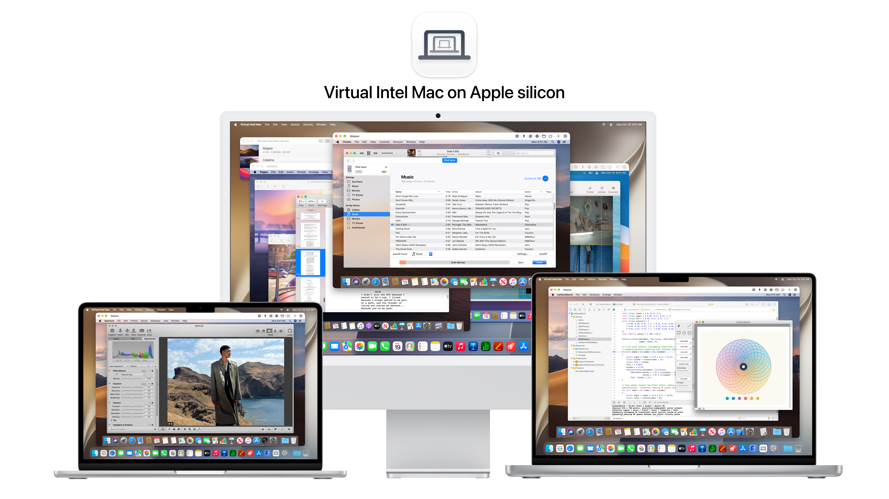

For the first time ever, run Intel versions of macOS Mojave, macOS Catalina, and macOS Big Sur on Apple silicon with Metal and OpenGL acceleration. This marks an exciting new milestone in the preservation of the history of Mac.

  

Virtual Intel Mac seamlessly integrates many technical breakthroughs into an intuitive Mac app. It supports Metal and OpenGL acceleration, Retina resolution, live resizing, USB and audio passthrough, shared and bridged networking, file sharing, remote login, clipboard sync, and more.

Virtual Intel Mac is a community project and is not affiliated with UTM, VirtualBuddy, Parallels Desktop, or Apple. Contributions are welcome!

## Frequently Asked Questions

### Which versions of macOS guests can I run?

You can run macOS Mojave 10.14, macOS Catalina 10.15, and macOS Big Sur 11 guests.

Metal and OpenGL acceleration are available in all supported macOS guest versions for 64-bit apps. On macOS Mojave, 32-bit apps run with software-based OpenGL. Contributions to expand support are welcome!

To avoid potential account lockouts, signing into iCloud or an Apple Account is not supported. Therefore, choose Set Up Later when asked. You can download apps from the web.

### Which versions of macOS do I need as the host?

Virtual Intel Mac works on macOS 27 Golden Gate, macOS Tahoe 26, and macOS Sequoia 15 hosts.

While the headline feature is to run Intel versions of macOS on Apple silicon with graphics acceleration, Virtual Intel Mac is actually a Universal app, meaning it works on both Apple silicon hosts and Intel hosts.

### Is it possible to support older versions of macOS guests?

Supporting macOS High Sierra 10.13 with Metal and OpenGL acceleration may be relatively straightforward. Supporting older versions such as OS X Mavericks 10.9 with OpenGL acceleration may require a different technical approach. Contributions are welcome!

### Is it possible to run newer versions of macOS guests?

To run macOS Monterey 12 or later guests on Apple silicon, use [UTM](https://mac.getutm.app), [VirtualBuddy](https://github.com/insidegui/VirtualBuddy), or [Virtual Mac on iPad](https://github.com/nfzerox/VirtualMacOniPad). You can then run Intel-based apps using Rosetta within the guest. To run macOS Monterey 12 or later guests on Intel, use [Parallels Desktop 26](https://www.parallels.com/products/desktop/pro/).

### What kind of performance does Virtual Intel Mac offer?

On Apple silicon hosts, Virtual Intel Mac supports hardware-accelerated graphics for GPU workloads and TCG emulation for CPU workloads. With the M4 chip, Virtual Intel Mac delivers roughly the same class of GPU performance as a MacBook Pro (15-inch, 2016) and CPU performance of MacBook Air (11-inch, Late 2010).

On Intel hosts, Virtual Intel Mac runs with near-native CPU and GPU performance.

### How long does it take to install macOS?

Installing macOS generally takes about an hour, and may take up to 2 hours. After macOS is installed, Virtual Intel Mac automatically installs graphics drivers to enable Metal and OpenGL acceleration, which generally takes about 15 minutes, and may take up to 30 minutes.

When installing macOS, the installer environment is expected to be software composited without Metal or OpenGL acceleration. Graphics acceleration is enabled after macOS installation is complete.

### What if I encounter crashes, bugs, or other issues?

First, [update to the latest version of Virtual Intel Mac](https://github.com/nfzerox/VirtualIntelMacOnAppleSilicon/releases). If the issue remains, point [Codex](https://chatgpt.com/codex) or [Claude Code](https://claude.com/product/claude-code) at this repository, then ask it to diagnose live and fix the issue. Because many issues can be setup-specific, this is usually the easiest way to fix issues. If you find a solution, please [open a pull request](https://github.com/nfzerox/VirtualIntelMacOnAppleSilicon/pulls). Contributions are welcome!

If you don't have access to frontier coding agents, [open a GitHub issue](https://github.com/nfzerox/VirtualIntelMacOnAppleSilicon/issues?q=is%3Aissue) when you encounter a crash, bug, or other problem. Include clear reproduction steps, a screenshot or screen recording, and a diagnostics file from Virtual Intel Mac's in-app Settings > Export Diagnostics.

## Screenshots

  <a href="Source/screenshots/Virtual_Intel_Mac_Multi_Window.png">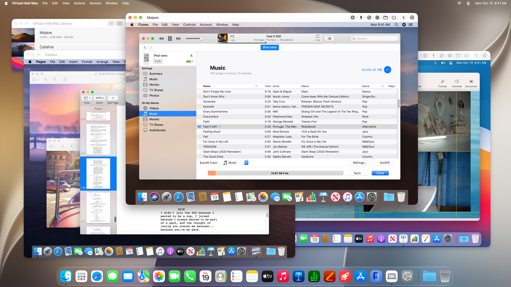</a>
  <a href="Source/screenshots/Virtual_Intel_Mac_Create_Version_Select.png">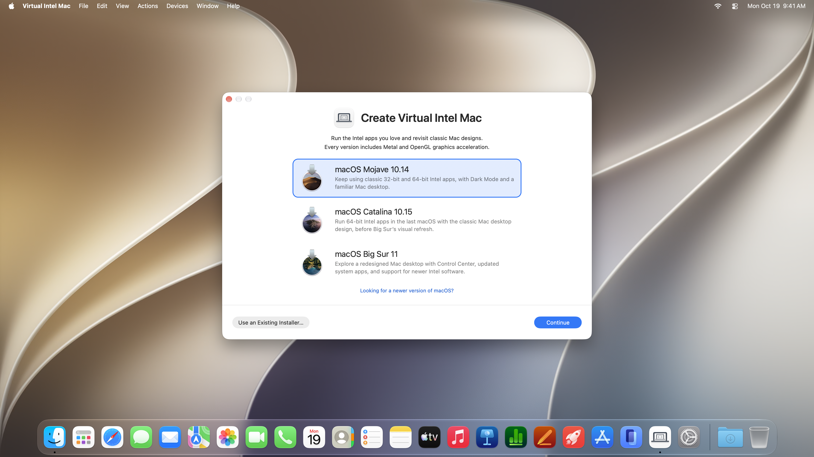</a>
  <a href="Source/screenshots/Virtual_Intel_Mac_Create_Configure.png">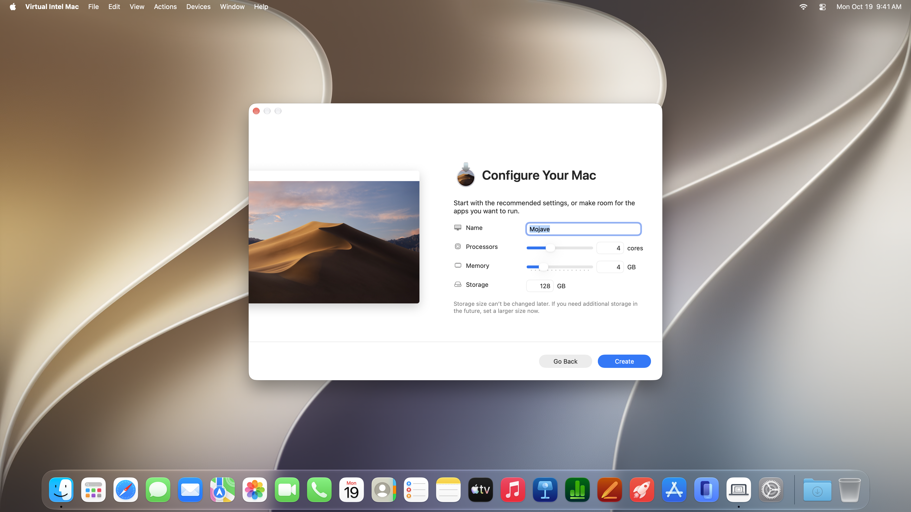</a>

  <a href="Source/screenshots/Virtual_Intel_Mac_Create_Download.png">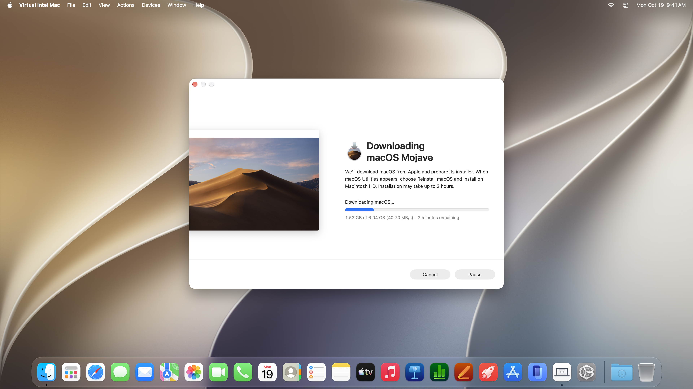</a>
  <a href="Source/screenshots/Virtual_Intel_Mac_Library_Expanded.png">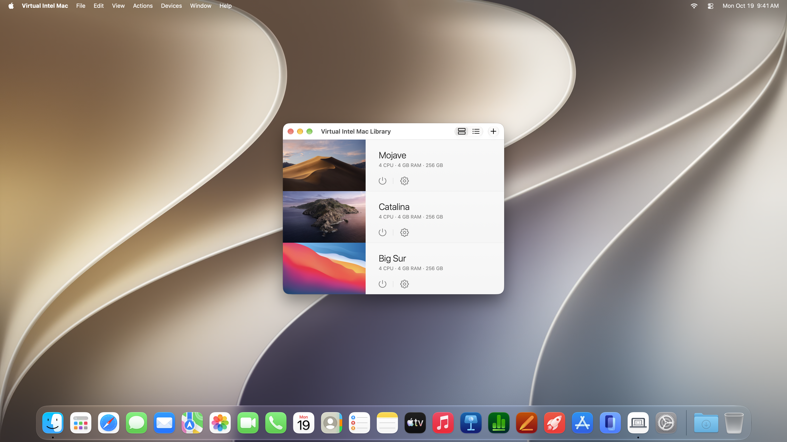</a>
  <a href="Source/screenshots/Virtual_Intel_Mac_Library_Compact.png">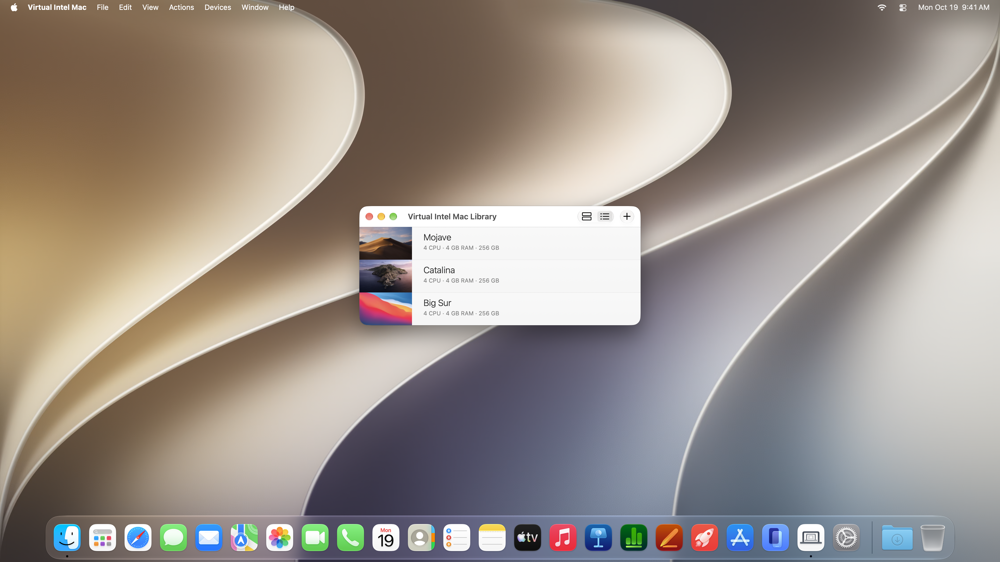</a>

  <a href="Source/screenshots/Virtual_Intel_Mac_Mojave_Aperture.png">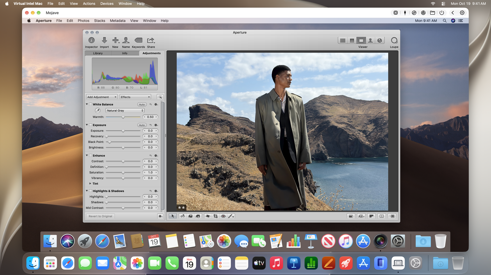</a>
  <a href="Source/screenshots/Virtual_Intel_Mac_Mojave_iTunes.png">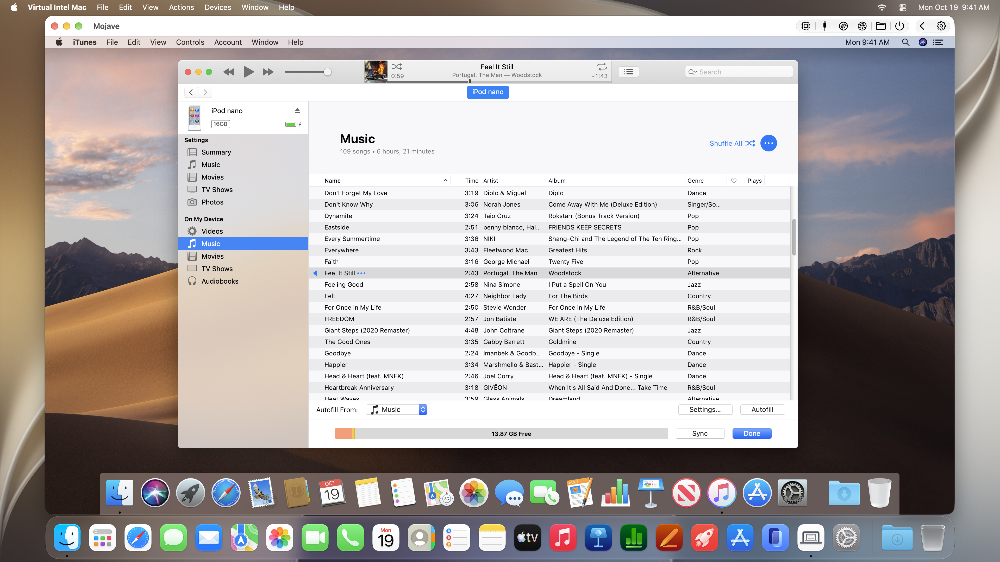</a>
  <a href="Source/screenshots/Virtual_Intel_Mac_Mojave_Xcode_Carbon.png">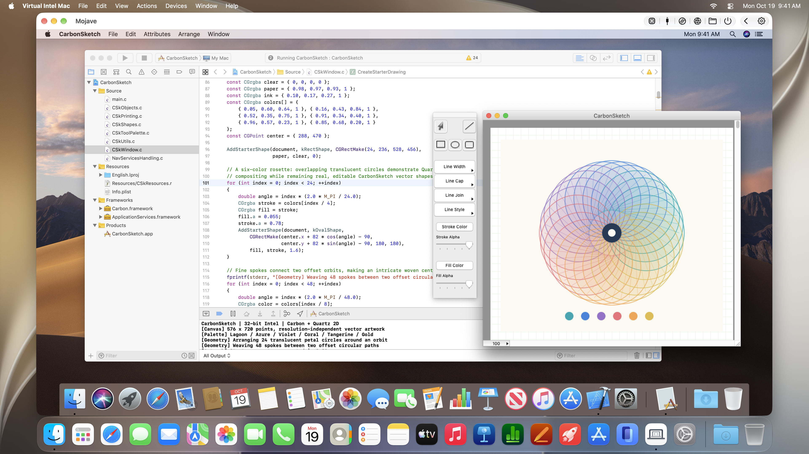</a>

  <a href="Source/screenshots/Virtual_Intel_Mac_Catalina_Pages_Preview.png">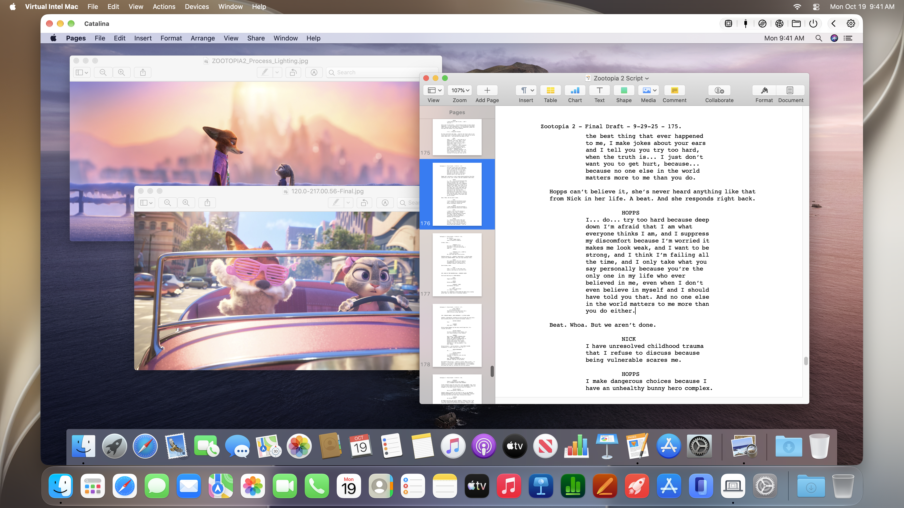</a>
  <a href="Source/screenshots/Virtual_Intel_Mac_Big_Sur_Keynote.png">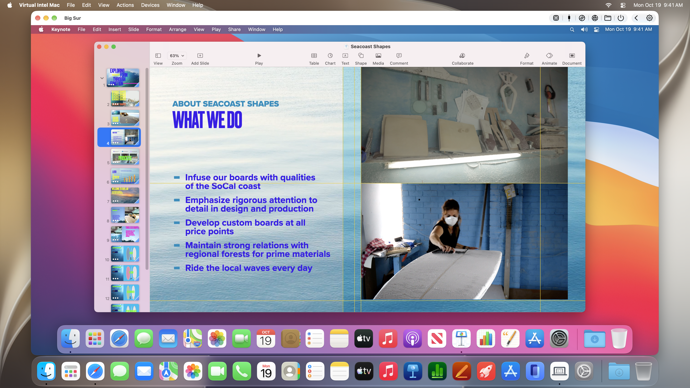</a>
  <a href="Source/screenshots/Virtual_Intel_Mac_Configure_General.png">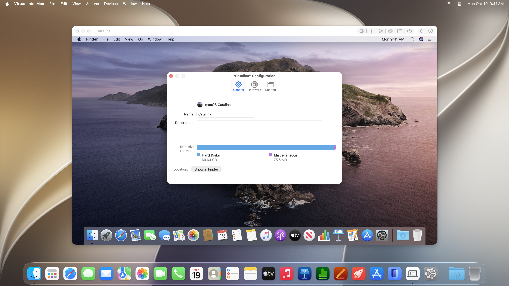</a>

  <a href="Source/screenshots/Virtual_Intel_Mac_Configure_Hardware.png">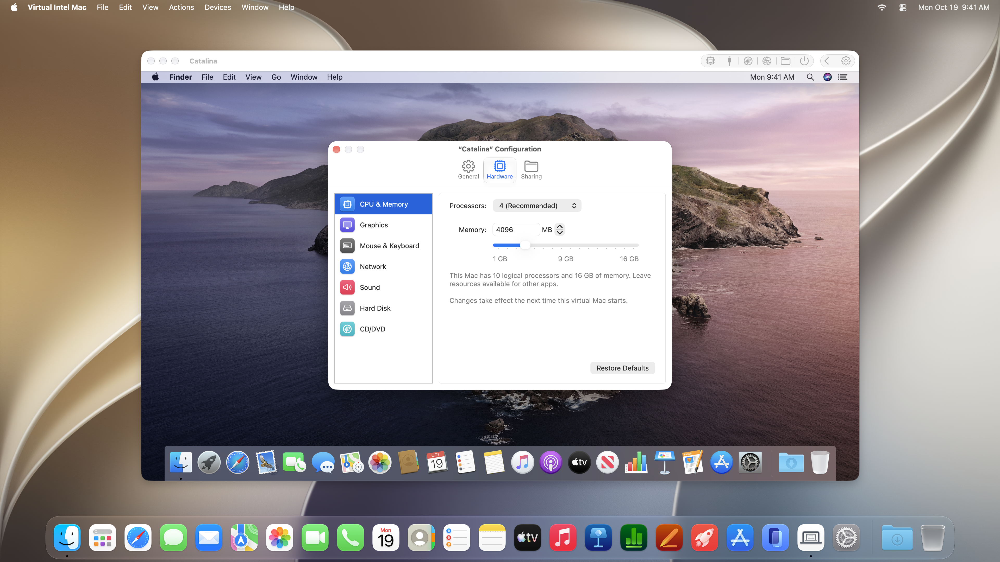</a>
  <a href="Source/screenshots/Virtual_Intel_Mac_Configure_Sharing.png">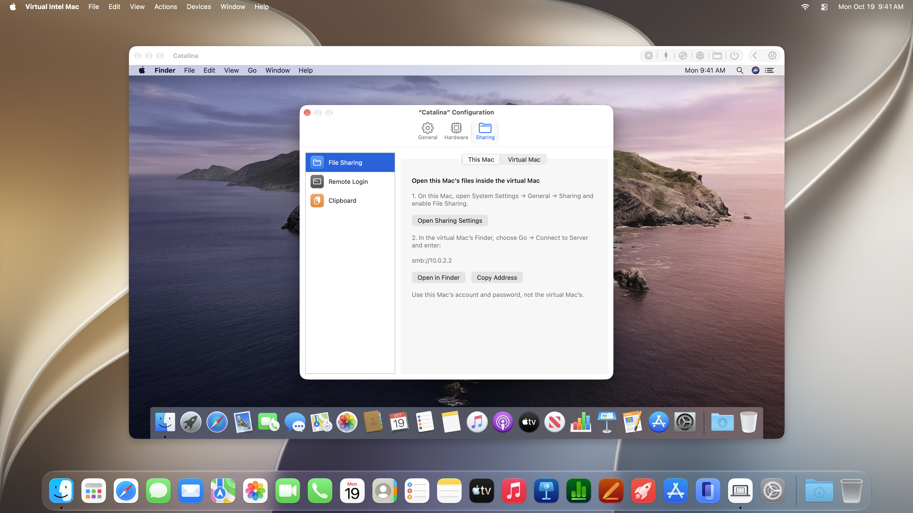</a>
  <a href="Source/screenshots/Virtual_Intel_Mac_Settings.png">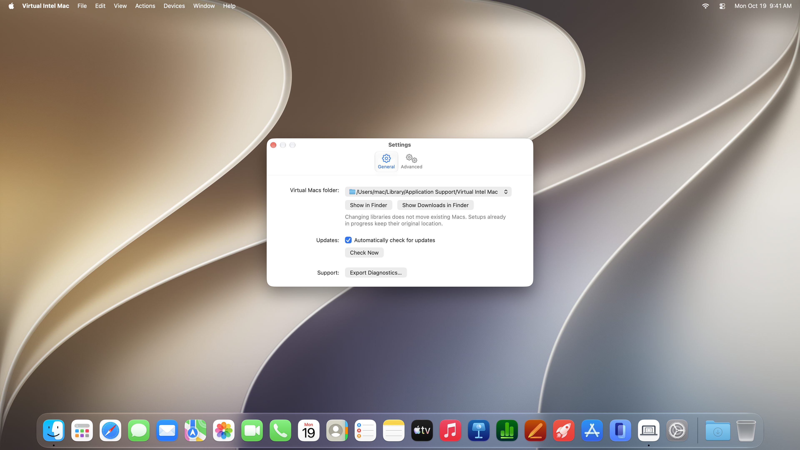</a>

## Technical Overview

Because the ParavirtualizedGraphics stack was first introduced in macOS Big Sur, creating Virtual Intel Mac means backporting its guest side to macOS Catalina and macOS Mojave. Since AppleParavirtGPU depends on Big Sur's changes to surface cache ownership and release, it is transplanted together with IOSurface, IOAcceleratorFamily2 and IOGraphicsFamily, with newer kernel APIs shimmed using [`PVGKernelCompat`](Source/compat/PVGKernelCompat/PVGKernelCompat.cpp). Guest-side [IOSurface and accelerator ABI translations](Source/compat/PVGIOSurfaceABI/PVGIOSurfaceABI.cpp), [surface-limit fixes](Source/compat/PVGIOSurfaceABI/PVGSurfaceLimits.h), and [framebuffer initialization](Source/compat/PVGFramebufferBootstrap/PVGFramebufferBootstrap.cpp) bridge the older display stack. [MetalSerializer is then extracted](Source/scripts/build-metalserializer) from Big Sur's dyld shared cache using [dsce](Source/vendor/source/dsce), and rebuilt for the [older Objective-C runtime](Source/compat/PVGMojaveObjC.m), including [Mojave's pipeline descriptor serialization](Source/compat/PVGMojavePipelineSerialization.m).

Big Sur's compiler plugin is built against LLVM 31001, whose C++ layouts differ from the LLVM 3902 in Mojave and Catalina. To bridge them, [`PVGCompilerPluginBridge`](Source/compat/PVGCompilerPluginBridge/PVGCompilerPluginBridge.c) has the guest's LLVM serialize each shader as bitcode and Big Sur's LLVM parse it back, so both compilers run side by side in one process. The [Metal compatibility layer](Source/compat/PVGMetalCompat/PVGMetalCompat.m) adapts command encoding and library loading, with [completion-layout recognition](Source/compat/PVGMetalCompat/PVGCompletionSite.h) and a [shader cache](Source/compat/PVGMetalCompat/PVGShaderCache.h) for the older guest stack.

OpenGL acceleration comes from Big Sur's Metal-based OpenGL renderer, with [`PVGOpenGLMetal`](Source/compat/PVGOpenGLProbe/PVGOpenGLMetal.m) filling in the Metal and IOSurface APIs it expects and a [small registration driver](Source/compat/PVGOpenGLProbe/PVGOpenGLProbe.cpp) connecting it to the virtual accelerator. On Mojave, it pairs with Catalina's 64-bit OpenGL frontend, [merged](Source/scripts/stage-opengl-universal.py) with Mojave's 32-bit slice to enable acceleration in 64-bit apps while also retaining software rendering for 32-bit apps. Its built-in shaders are [downgraded](Source/scripts/opengl-downgrade-builtins) to Mojave's AIR 2.1, while [pixel-buffer lifetime compatibility](Source/compat/PVGOpenGLProbe/PVGCGLPBufferCompat.m) handles older CGL clients.

On Apple silicon, the arm64e slice of ParavirtualizedGraphics uses a different wire protocol compared to the x86_64 slice; therefore, the Intel slice is run through an [x86_64 helper](Source/vendor/qemu/hw/display/apple-gfx-helper.m) under Rosetta 2 while [sharing guest memory](Source/vendor/qemu/hw/display/apple-gfx.m) with arm64 QEMU. Since Metal rejects buffers spanning fragmented 4 KB guest pages on a 16 KB page host, the helper [shadows them with GPU scatter and gather blits](Source/vendor/qemu/hw/display/apple-gfx-legacy-shadow.m). An update to Virtual Intel Mac is planned for macOS 28 and later so it continues to work after the removal of Rosetta 2.

To make x86 emulation faster and improve guest UI responsiveness, changes are also made to QEMU to [keep translations and page table lookups across guest context switches](Source/vendor/qemu/accel/tcg/cputlb.c) and [cache indirect jump targets inline](Source/vendor/qemu/tcg/aarch64/tcg-target.c.inc). It also [executes packed SSE arithmetic natively](Source/vendor/qemu/target/i386/tcg/emit.c.inc) on Apple silicon. Additional QEMU optimizations are made to reduce [audio skips and crackling](Source/vendor/qemu/hw/audio/hda-codec.c), as well as improve [USB passthrough](Source/USBHelper/main.m) and [networking support](Source/NetworkHelper/main.m).

## Credits

Virtual Intel Mac is made possible thanks to learnings from building [Virtual Mac on iPad](https://github.com/nfzerox/VirtualMacOniPad), further advances in agentic coding, and these excellent open source projects:

- [QEMU](https://www.qemu.org) provides x86_64 emulation and the `apple-gfx-pci` device that connects Intel guests to Apple's paravirtualized graphics framework.
- [dsce](https://github.com/moraea/dsce) makes it possible to extract loadable x86_64 libraries from Big Sur's and macOS 26's dyld shared caches.
- [reims-vgpu](https://github.com/steelbrain/reims-vgpu) provides an invaluable reference for the paravirtualized graphics protocol.
- [Lilu](https://github.com/acidanthera/Lilu) and [MacKernelSDK](https://github.com/acidanthera/MacKernelSDK) underpin this project's kernel compatibility extensions.
- [OpenCore](https://github.com/acidanthera/OpenCorePkg) and [OpenCore-ISO](https://github.com/LongQT-sea/OpenCore-ISO) boot macOS in QEMU.
- [macos-iso-builder](https://github.com/LongQT-sea/macos-iso-builder) informs this project's installer media assembly.
- [VoodooHDA](https://sourceforge.net/projects/voodoohda/) brings sound to macOS Mojave and macOS Catalina guests.
- [EDK II](https://github.com/tianocore/edk2) provides the UEFI firmware and libraries used by the boot-policy driver.
- [UTM](https://github.com/utmapp/UTM) provides references for split process graphics, networking and USB integration on macOS.
