# Virtual Intel Mac on Apple silicon

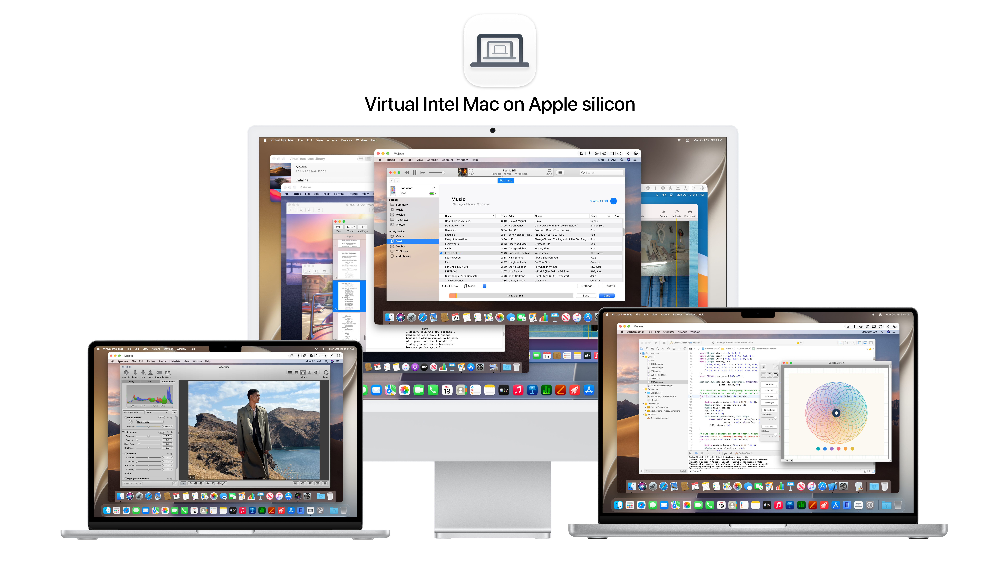

For the first time ever, run every Intel version of macOS between Mac OS X Tiger 10.4 and macOS Big Sur 11 on Apple silicon with graphics acceleration, so you can run older 32-bit and 64-bit Intel apps like iWork ’09, iLife ’11, Aperture, Final Cut Pro 7, and Front Row, or PowerPC apps like AppleWorks, and re-experience iconic Aqua desktop effects like the translucent menu bar, reflective blurred Dock, and water ripple animation in Dashboard. This marks an exciting new chapter in the preservation of the history of Mac.

  

Virtual Intel Mac seamlessly integrates many technical breakthroughs into an intuitive Mac app. It uses Hybrid Hypervisor for fast Intel emulation on Apple silicon, supports Metal and OpenGL acceleration, 32-bit and 64-bit Intel apps, PowerPC apps, Retina resolution, live resizing, automatic setup, USB and audio passthrough, shared and bridged networking, file sharing, remote login, clipboard sync, and more.

Virtual Intel Mac is a community project and is not affiliated with UTM, VirtualBuddy, Parallels Desktop, or Apple. Contributions are welcome!

## Frequently Asked Questions

### Which versions of macOS guests can I run?

You can run Mac OS X Tiger 10.4, Mac OS X Leopard 10.5, Mac OS X Snow Leopard 10.6, Mac OS X Lion 10.7, OS X Mountain Lion 10.8, OS X Mavericks 10.9, OS X Yosemite 10.10, OS X El Capitan 10.11, macOS Sierra 10.12, macOS High Sierra 10.13, macOS Mojave 10.14, macOS Catalina 10.15, and macOS Big Sur 11 guests.

OpenGL acceleration is available in Mac OS X Tiger 10.4 up to macOS Big Sur 11 guests. Metal acceleration is available in macOS Mojave 10.14, macOS Catalina 10.15, and macOS Big Sur 11 guests. Contributions to expand app and game compatibility are welcome!

To avoid potential account lockouts, signing into iCloud or an Apple Account is not supported. You can download apps from the web.

### Which versions of macOS do I need as the host?

Virtual Intel Mac works on macOS 27 Golden Gate, macOS Tahoe 26, and macOS Sequoia 15 hosts.

While the headline feature is to run Intel versions of macOS on Apple silicon with graphics acceleration, Virtual Intel Mac is actually a Universal app, meaning it works on both Apple silicon hosts and Intel hosts.

### What kind of performance does Virtual Intel Mac offer?

On Apple silicon hosts, Virtual Intel Mac supports Hybrid Hypervisor for CPU workloads and hardware-accelerated graphics for GPU workloads. With the M4 chip, Virtual Intel Mac delivers roughly the same class of CPU performance as MacBook Pro (13-inch, Mid 2020) and GPU performance as MacBook Pro (16-inch, 2019) with Radeon Pro 5500M.

On Intel hosts, Virtual Intel Mac runs with near-native CPU and GPU performance.

### How long does it take to install macOS?

Installing macOS generally takes about a few minutes after download.

### What if I encounter crashes, bugs, or other issues?

First, [update to the latest version of Virtual Intel Mac](https://github.com/nfzerox/VirtualIntelMacOnAppleSilicon/releases), and temporarily uninstall tweaks such as [Ammonia](https://github.com/CoreBedtime/ammonia) which may generally cause compatibility issues with virtualization software.

If the issue remains, point [Codex](https://chatgpt.com/codex) or [Claude Code](https://claude.com/product/claude-code) at this repository, then ask it to diagnose live and fix the issue. Because many issues can be specific to the overall setup, or apps and games you'd like to run, this is usually the easiest way to fix issues. If you find a solution, please [open a pull request](https://github.com/nfzerox/VirtualIntelMacOnAppleSilicon/pulls). Contributions are welcome!

If you don't have access to frontier coding agents, [open a GitHub issue](https://github.com/nfzerox/VirtualIntelMacOnAppleSilicon/issues?q=is%3Aissue) when you encounter a crash, bug, or other problem. Include clear reproduction steps, a screenshot or screen recording, and a diagnostics file from Virtual Intel Mac's in-app Settings > Export Diagnostics.

## Screenshots

  <a href="Source/screenshots/Virtual_Intel_Mac_Multi_Window.png">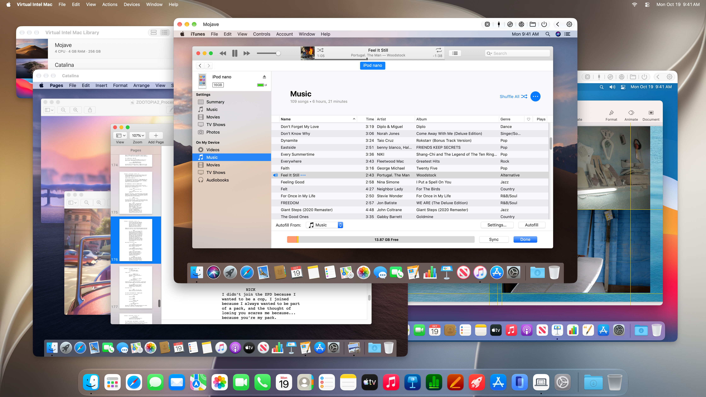</a>
  <a href="Source/screenshots/Virtual_Intel_Mac_Create_Version_Select.png">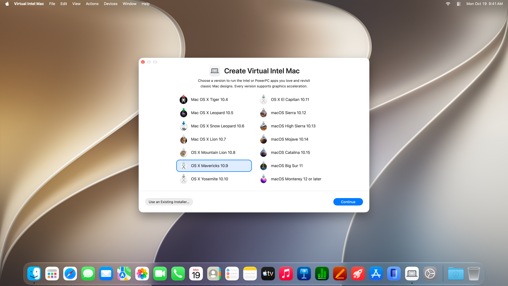</a>
  <a href="Source/screenshots/Virtual_Intel_Mac_Create_Configure.png">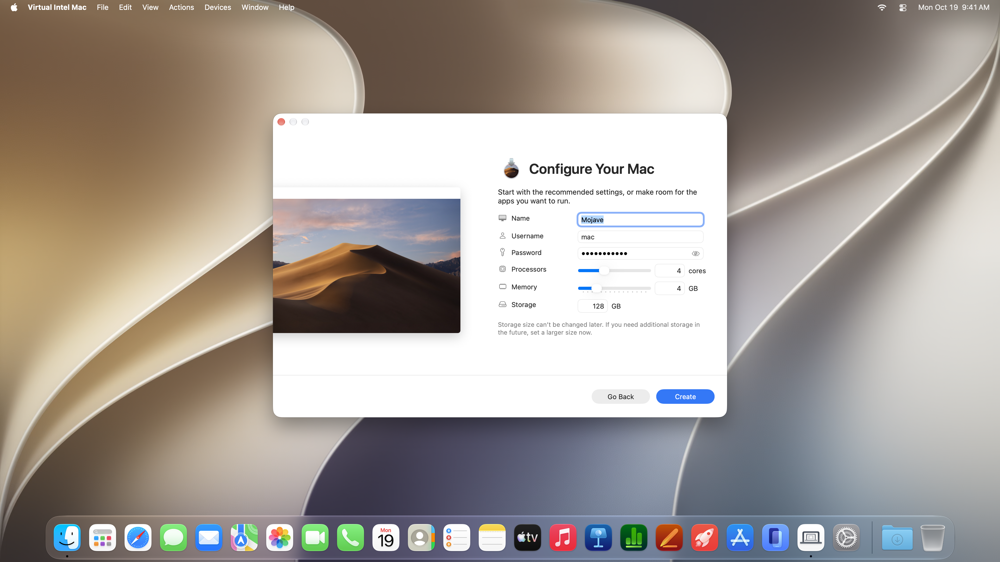</a>

  <a href="Source/screenshots/Virtual_Intel_Mac_Create_Download.png">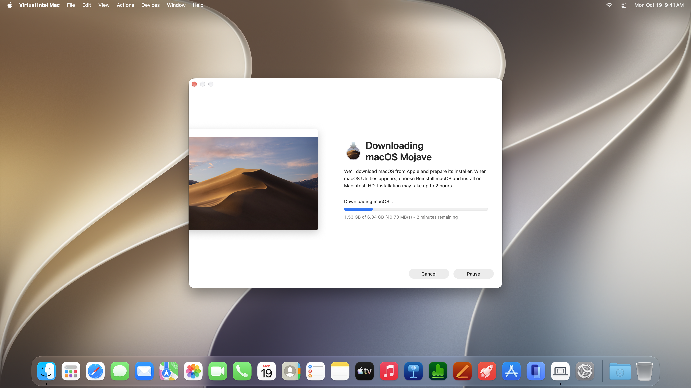</a>
  <a href="Source/screenshots/Virtual_Intel_Mac_Library_Expanded.png">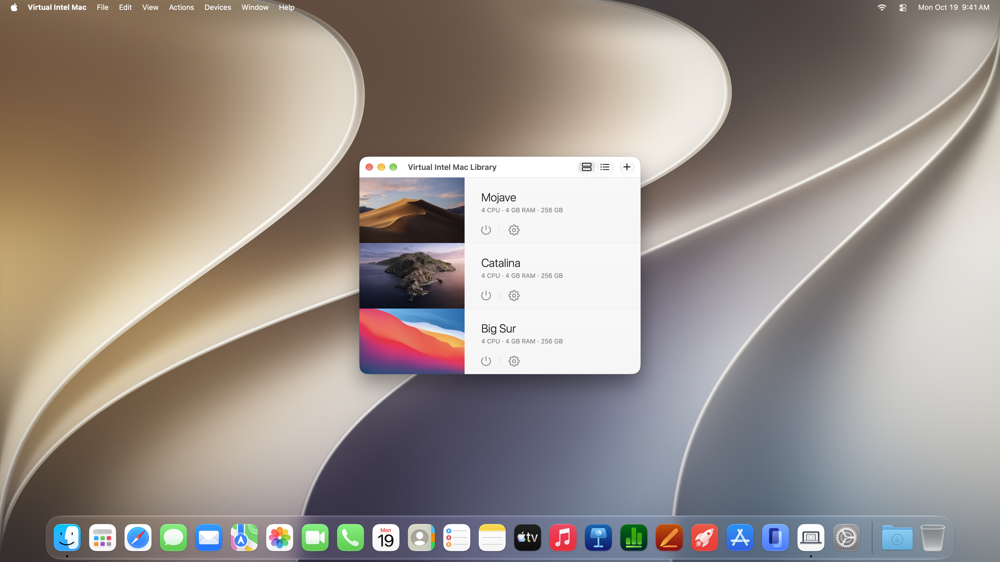</a>
  <a href="Source/screenshots/Virtual_Intel_Mac_Library_Compact.png">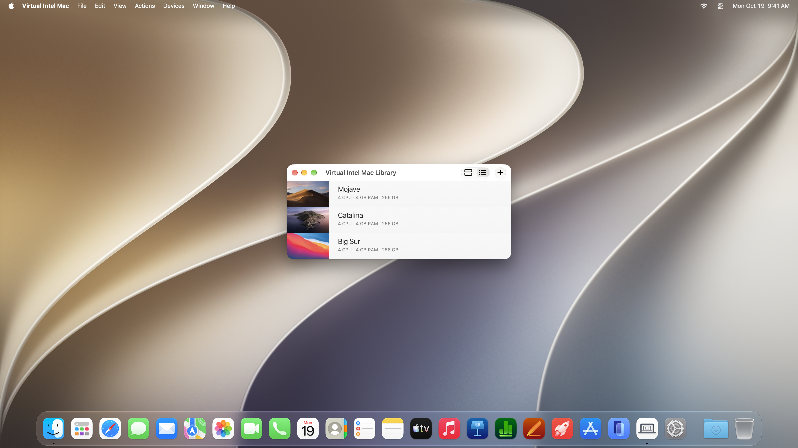</a>

  <a href="Source/screenshots/Virtual_Intel_Mac_Mojave_Aperture.png">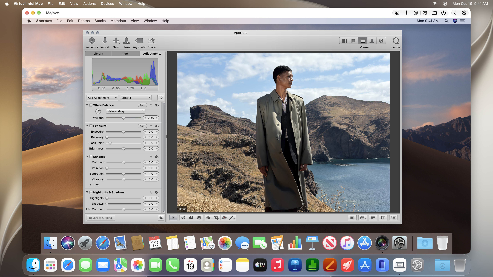</a>
  <a href="Source/screenshots/Virtual_Intel_Mac_Mojave_iTunes.png">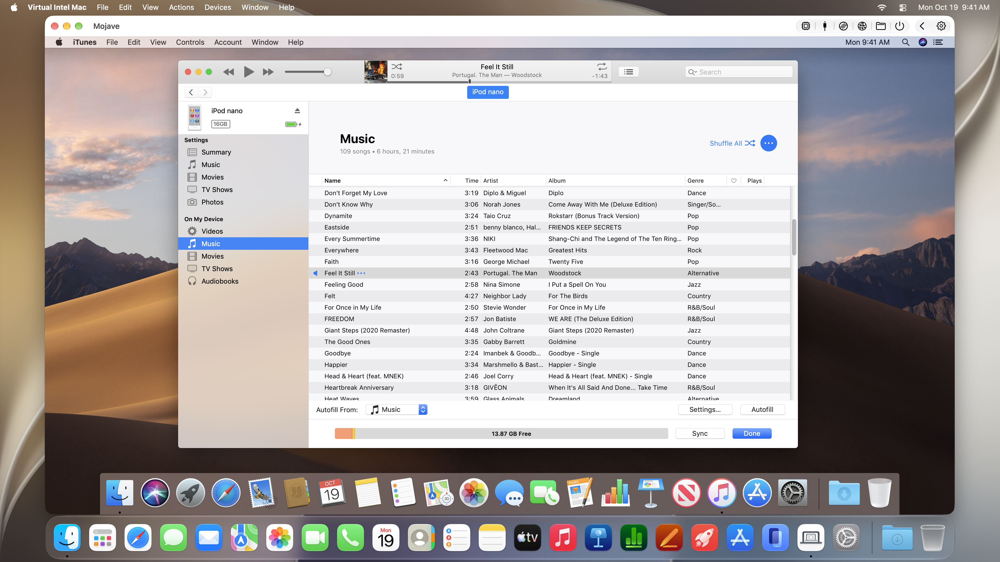</a>
  <a href="Source/screenshots/Virtual_Intel_Mac_Mojave_Xcode_Carbon.png">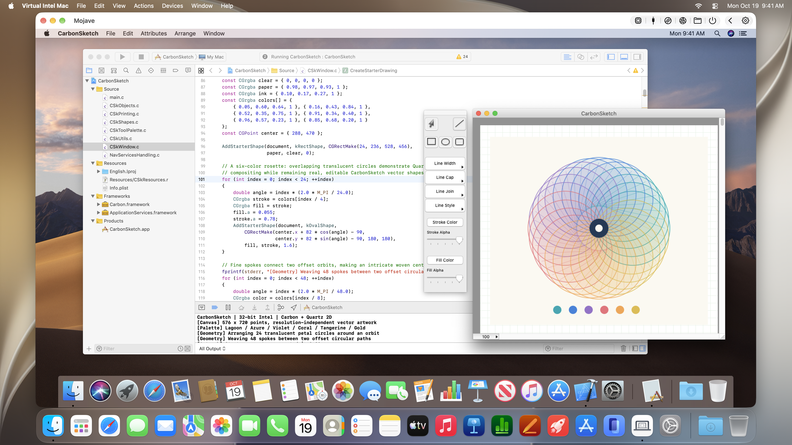</a>

  <a href="Source/screenshots/Virtual_Intel_Mac_Catalina_Pages_Preview.png">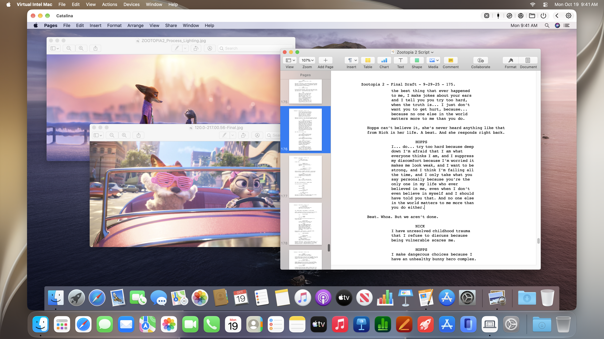</a>
  <a href="Source/screenshots/Virtual_Intel_Mac_Big_Sur_Keynote.png">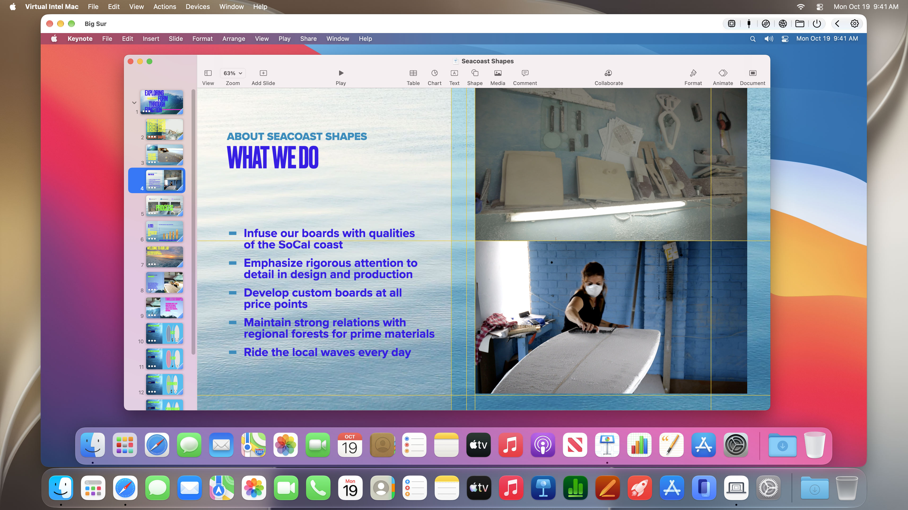</a>
  <a href="Source/screenshots/Virtual_Intel_Mac_Configure_General.png">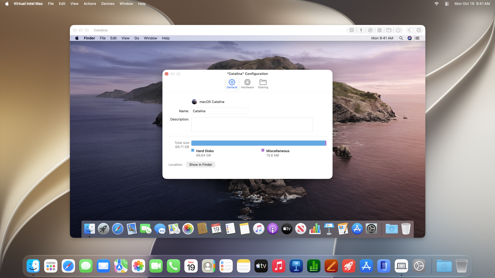</a>

  <a href="Source/screenshots/Virtual_Intel_Mac_Configure_Hardware.png">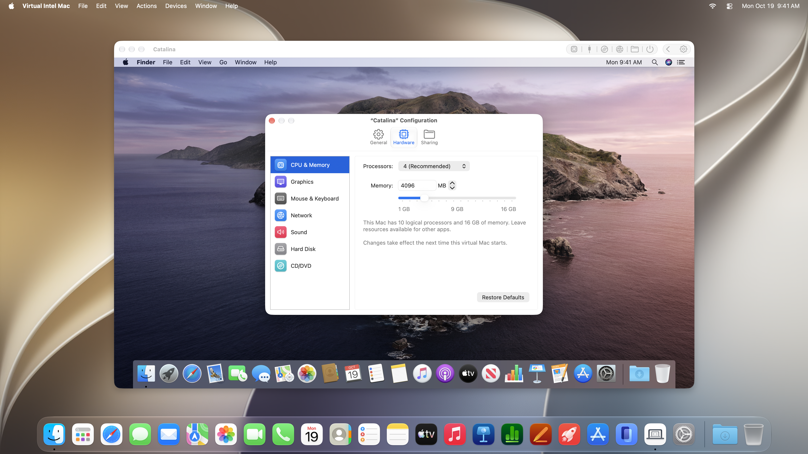</a>
  <a href="Source/screenshots/Virtual_Intel_Mac_Configure_Sharing.png">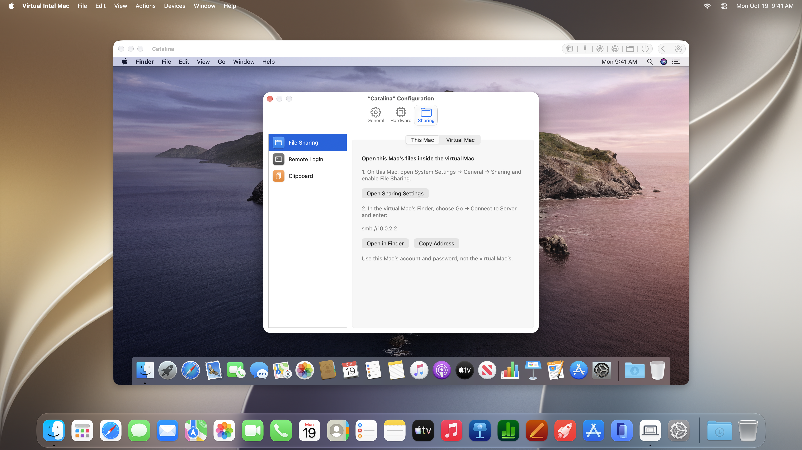</a>
  <a href="Source/screenshots/Virtual_Intel_Mac_Settings.png">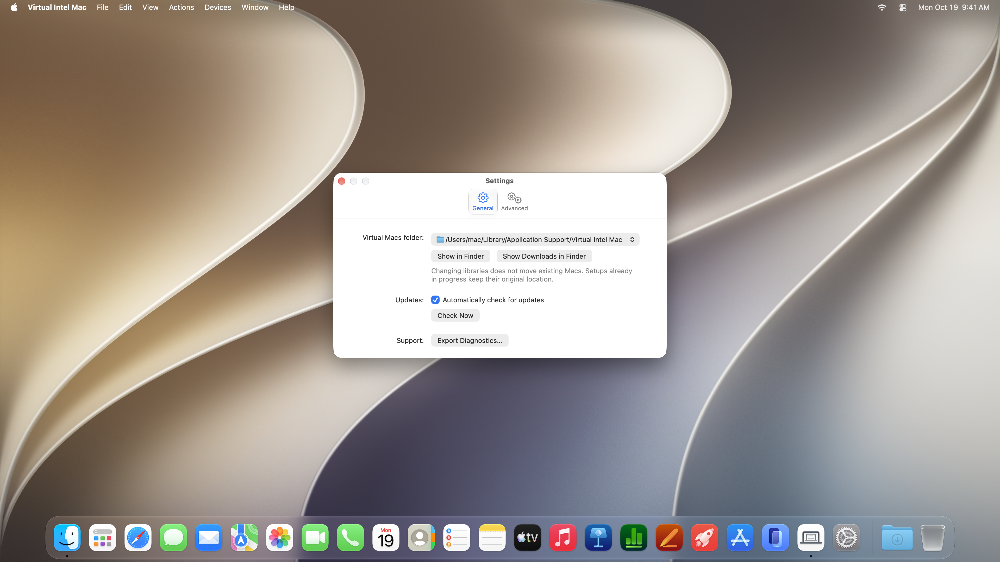</a>

  
  <a href="Source/screenshots/Virtual_Intel_Mac_Geekbench_TCG_Emulation_CPU.png">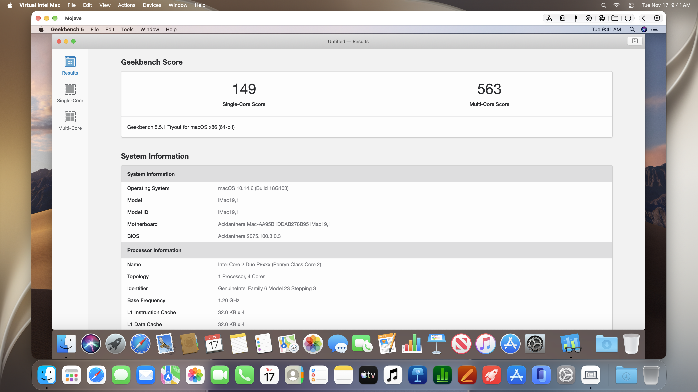</a>
  <a href="Source/screenshots/Virtual_Intel_Mac_Geekbench_Metal.png">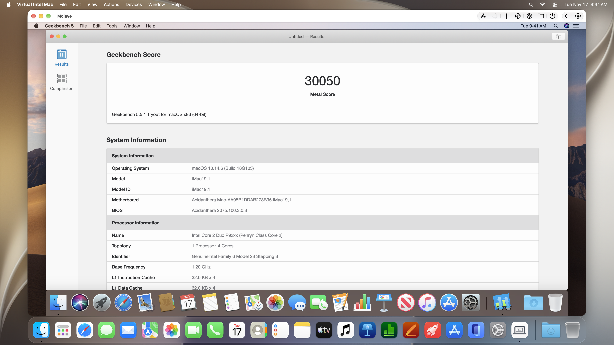</a>

## Technical Overview

As the world's first high performance full-system x86_64 emulation engine on arm64 hosts, [Hybrid Hypervisor](Source/HybridHypervisor) premieres with Virtual Intel Mac and is permissively licensed under MIT for developers to improve upon and virtualization apps to integrate. It [translates x86 instructions into AArch64 blocks](Source/HybridHypervisor/Sources/CEngine/translate.c) and runs them inside a [Hypervisor.framework virtual machine](Source/HybridHypervisor/Sources/Engine/Engine.swift), using hardware-backed shadow paging and x86-compatible memory ordering. A small [in-VM monitor](Source/HybridHypervisor/Monitor/monitor.c) handles page tables, exceptions, and frequent kernel operations without returning to the host for each operation. [QEMU's handoff layer](Source/vendor/qemu/target/i386/tcg/system/hvdbt.c) synchronizes CPU state when execution falls back to TCG, while QEMU continues to emulate devices and timers through the engine's [C interface](Source/HybridHypervisor/Sources/Engine/EngineAPI.swift).

For Tiger up to Mojave guests, the groundbreaking [PassthroughOpenGL](Source/PassthroughOpenGL) implementation connects a compiled [GLD engine](Source/PassthroughOpenGL/passthrough-opengl-gli.c) to the host's [native hardware OpenGL executor](Source/PassthroughOpenGL/passthrough-opengl-host.c). [Generated dispatch marshalling](Source/scripts/generate-passthrough-opengl.py) carries the guest's OpenGL calls, while [shared-memory render targets](Source/PassthroughOpenGL/direct-vram-render-target-host.c) and [surface publication](Source/PassthroughOpenGL/direct-iosurface-writes.h) enables fast graphics routing. The [VMsvga2-derived guest drivers](Source/vendor/source/VMsvga2) supply framebuffer and surface integration.

Because the ParavirtualizedGraphics stack was first introduced in macOS Big Sur, enabling Metal in macOS Catalina and macOS Mojave guests means backporting its guest side support. Since AppleParavirtGPU depends on Big Sur's changes to surface cache ownership and release, it is transplanted together with IOSurface, IOAcceleratorFamily2 and IOGraphicsFamily, with newer kernel APIs shimmed using [`PVGKernelCompat`](Source/compat/PVGKernelCompat/PVGKernelCompat.cpp). Guest-side [IOSurface and accelerator ABI translations](Source/compat/PVGIOSurfaceABI/PVGIOSurfaceABI.cpp), [surface-limit fixes](Source/compat/PVGIOSurfaceABI/PVGSurfaceLimits.h), and [framebuffer initialization](Source/compat/PVGFramebufferBootstrap/PVGFramebufferBootstrap.cpp) bridge the older display stack. [MetalSerializer is then extracted](Source/scripts/build-metalserializer) from Big Sur's dyld shared cache using [dsce](Source/vendor/source/dsce), and rebuilt for the [older Objective-C runtime](Source/compat/PVGMojaveObjC.m), including [Mojave's pipeline descriptor serialization](Source/compat/PVGMojavePipelineSerialization.m).

Big Sur's compiler plugin is built against LLVM 31001, whose C++ layouts differ from the LLVM 3902 in Mojave and Catalina. To bridge them, [`PVGCompilerPluginBridge`](Source/compat/PVGCompilerPluginBridge/PVGCompilerPluginBridge.c) has the guest's LLVM serialize each shader as bitcode and Big Sur's LLVM parse it back, so both compilers run side by side in one process. The [Metal compatibility layer](Source/compat/PVGMetalCompat/PVGMetalCompat.m) adapts command encoding and library loading, with [completion-layout recognition](Source/compat/PVGMetalCompat/PVGCompletionSite.h) and a [shader cache](Source/compat/PVGMetalCompat/PVGShaderCache.h) for the older guest stack.

OpenGL acceleration on Catalina comes from Big Sur's Metal-based OpenGL renderer, with [`PVGOpenGLMetal`](Source/compat/PVGOpenGLProbe/PVGOpenGLMetal.m) filling in the Metal and IOSurface APIs it expects and a [small registration driver](Source/compat/PVGOpenGLProbe/PVGOpenGLProbe.cpp) connecting it to the virtual accelerator. Its built-in shaders are [downgraded](Source/scripts/opengl-downgrade-builtins) to Mojave's AIR 2.1, while [pixel-buffer lifetime compatibility](Source/compat/PVGOpenGLProbe/PVGCGLPBufferCompat.m) handles older CGL clients.

On Apple silicon, the arm64e slice of ParavirtualizedGraphics uses a different wire protocol compared to the x86_64 slice; therefore, the Intel slice is run through an [x86_64 helper](Source/vendor/qemu/hw/display/apple-gfx-helper.m) under Rosetta 2 while [sharing guest memory](Source/vendor/qemu/hw/display/apple-gfx.m) with arm64 QEMU. Since Metal rejects buffers spanning fragmented 4 KB guest pages on a 16 KB page host, the helper [shadows them with GPU scatter and gather blits](Source/vendor/qemu/hw/display/apple-gfx-legacy-shadow.m). An update to Virtual Intel Mac is planned for macOS 28 and later so it continues to work after the removal of Rosetta 2.

Additional QEMU optimizations are made to reduce [audio skips and crackling](Source/vendor/qemu/hw/audio/hda-codec.c), as well as improve [USB passthrough](Source/USBHelper/main.m) and [networking support](Source/NetworkHelper/main.m).

## Credits

Virtual Intel Mac is made possible thanks to learnings from building [Virtual Mac on iPad](https://github.com/nfzerox/VirtualMacOniPad), further advances in agentic coding, and these excellent open source projects:

- [QEMU](https://www.qemu.org) provides x86_64 emulation and the `apple-gfx-pci` device that connects Intel guests to Apple's paravirtualized graphics framework.
- [Hybrid Hypervisor](Source/HybridHypervisor), invented by Sam Henri Gold (developer of Light Touch), delivers up to 8x faster CPU emulation on Apple silicon.
- [dsce](https://github.com/moraea/dsce) makes it possible to extract loadable x86_64 libraries from Big Sur's and macOS 26's dyld shared caches.
- [reims-vgpu](https://github.com/steelbrain/reims-vgpu) provides an invaluable reference for the paravirtualized graphics protocol.
- [Lilu](https://github.com/acidanthera/Lilu) and [MacKernelSDK](https://github.com/acidanthera/MacKernelSDK) underpin this project's kernel compatibility extensions.
- [OpenCore](https://github.com/acidanthera/OpenCorePkg) and [OpenCore-ISO](https://github.com/LongQT-sea/OpenCore-ISO) boot macOS in QEMU.
- [macos-iso-builder](https://github.com/LongQT-sea/macos-iso-builder) informs this project's installer media assembly.
- [VoodooHDA](https://sourceforge.net/projects/voodoohda/) brings sound to Tiger through Catalina guests.
- [EDK II](https://github.com/tianocore/edk2) provides the UEFI firmware and libraries used by the boot-policy driver.
- [UTM](https://github.com/utmapp/UTM) provides references for split process graphics, networking and USB integration on macOS.
- [OpenSSH Portable](https://www.openssh.org/portable.html) and [LibreSSL](https://www.libressl.org) provide the isolated SSH client for older OS X guests, without changing the host's SSH security policy.
- [JSONKit](https://github.com/johnezang/JSONKit) provides JSON serialization for Snow Leopard's guest-control tools, outside the graphics hot path.
- [Samba](https://www.samba.org) supplies SMB compatibility components for older guests.
- The native SMB client backports include software developed by [Boris Popov](https://github.com/apple-oss-distributions/smb), with Apple's Darwin8/9 filesystem interfaces preserved.
- [libusb](https://libusb.info) and [usbredir](https://www.spice-space.org/usbredir.html) provide the USB capture and redirection libraries used by the USB helper.
- [XZ Utils](https://tukaani.org/xz/) provides compression for the bundled guest payloads.
- [VMsvga2](https://sourceforge.net/projects/vmsvga2/) by Zenith432 provides the framebuffer and surface-driver foundation for PassthroughOpenGL.
- [gfxCardStatus](https://github.com/codykrieger/gfxCardStatus) informs the physical-reference-only Intel GPU selection probe, not the shipped VM runtime.
